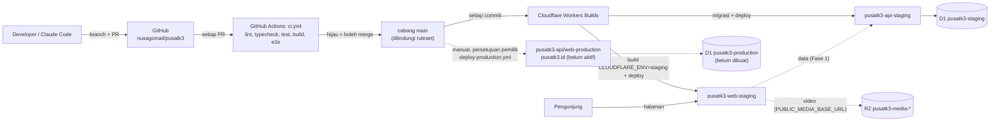

# Arsitektur

## Prinsip

- **API-first:** semua logika bisnis di `apps/api`; web dan mobile hanya klien.
- **Edge-cache halaman publik:** sebagian besar trafik dilayani dari CDN; database hanya untuk yang dinamis.
- **Satu sumber data:** jadwal diperbarui sekali, tampil di direktori, profil, dan website instan.

## Peta sistem



Garis putus-putus = belum aktif. Staging: https://pusatk3-web-staging.nusagomail.workers.dev (web) dan https://pusatk3-api-staging.nusagomail.workers.dev/api/v1/health (API). Semua resource ada di satu akun Cloudflare yang juga dipakai selfgrow (ADR 0016, `docs/akses.md`).

## Struktur repo

```
apps/
  web/        Astro di Cloudflare (prerender bawaan, SSR bila perlu data segar) — halaman publik + dashboard (komponen React, Fase 2)
  api/        Hono di Cloudflare Workers — REST /api/v1
  mobile/     Expo (Fase 5)
packages/
  shared/     tipe, skema Zod, konstanta (peran, status, penerbit); kategori K3 ada di DB (seed)
  db/         skema Drizzle + migrasi D1
  ui/         design tokens + komponen (opsional, bila dipakai web & mobile)
docs/
.claude/
```

## Komponen Cloudflare

| Kebutuhan | Layanan |
| --- | --- |
| Web | Astro di Cloudflare (Workers) |
| API | Workers + Hono |
| Database | D1 (`pusatk3-staging`, `pusatk3-production`) via Drizzle |
| File & gambar | R2 + Cloudflare Images |
| Cache data ringan | KV (mis. query populer) |
| Proses latar | Queues (notifikasi lead), Cron Triggers (jadwal kedaluwarsa, pengingat) |
| Anti-bot | Turnstile di semua form |
| Keamanan | WAF, rate limiting |
| Website instan | Cloudflare for SaaS (Custom Hostnames) |

Layanan pihak ketiga: Meilisearch/Typesense (pencarian), Resend (email), Midtrans/Xendit (pembayaran, Fase 4), Sentry, PostHog.

## Alur cache halaman publik

1. Request ke halaman publik → cek cache CDN.
2. Miss → halaman prerender disajikan dari aset statis; halaman SSR dirender dengan data dari API dan **disimpan lewat Cache API/Cache Rules** (header `s-maxage` + `stale-while-revalidate` saja tidak membuat respons Worker masuk cache). Rincian: ADR 0010.
3. Penyedia mengubah jadwal/profil → API memasukkan tugas ke Queue → purge URL terkait (profil, detail jadwal, halaman kota × kategori).

## Lingkungan

| Lingkungan | API | Web | Database | Diindeks | Deploy |
| --- | --- | --- | --- | --- | --- |
| `local` | `pnpm dev` (127.0.0.1:8787) | `pnpm dev` (localhost:4321) | D1 lokal (`.wrangler/`) | tidak | — |
| `staging` | `pusatk3-api-staging` (`*.workers.dev`) | `pusatk3-web-staging` (`*.workers.dev`) | `pusatk3-staging` | tidak (`noindex`) | otomatis dari `main` (Cloudflare Workers Builds, ADR 0015) |
| `production` | `pusatk3-api-production` (`pusatk3.id/api/*`) | `pusatk3-web-production` (`pusatk3.id/*`) | `pusatk3-production` | ya | manual, persetujuan pemilik |

Konfigurasi: `apps/{api,web}/wrangler.jsonc` (`env.staging`, `env.production`). Keputusan: ADR 0011 (lingkungan) dan ADR 0012 (CI/deploy, `.github/workflows/`), ADR 0013 (e2e Playwright), ADR 0015 (staging lewat Workers Builds). Langkah pemilik (domain, resource production, secret): `docs/setup-cloudflare.md`.

## Keputusan

Lihat `docs/adr/`.
